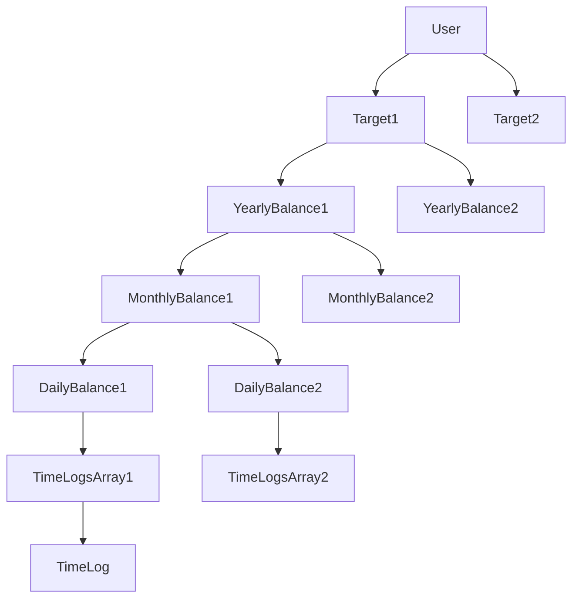
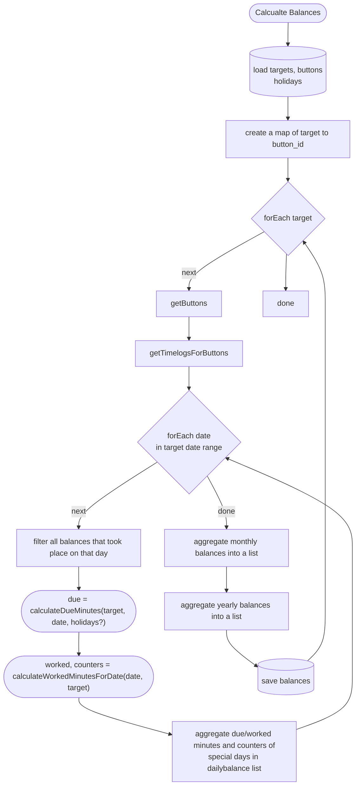
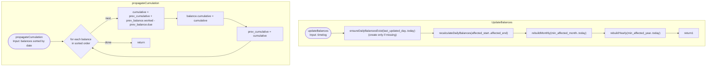
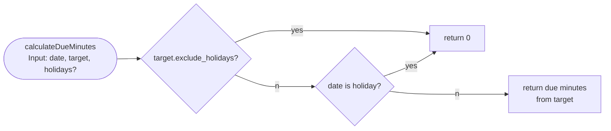
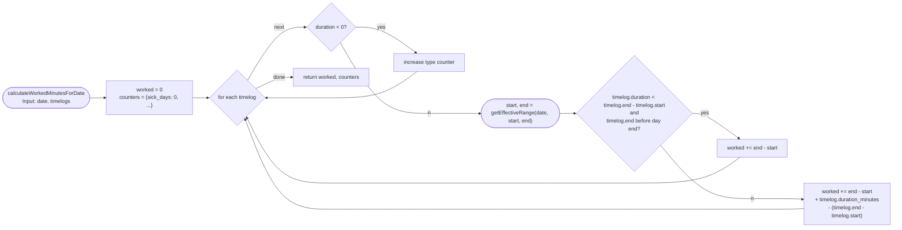
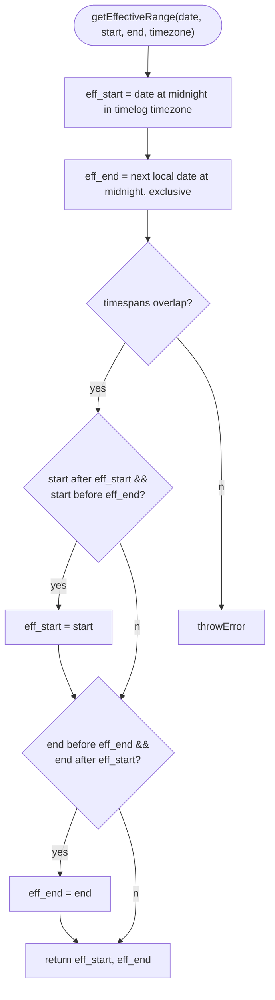
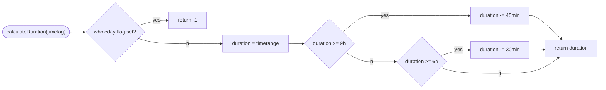

# Balance Calculations

Balances are calculated bottom up. All balances are of type Balance. Yearly, monthly, and daily entries share the frontend balances table, distinguished by their date format. If any object in a chain from timelog to target changes, propagate the change up to the respective target. No hashing; instead offer a recalculation button. All balances are synced to the backend to lower initial setup time after login.

If a timelog spans midnight or multiple days, only the effective range is used. In other words: the time span is clipped for the specific date and breaks are only considered, if the log ends before the respective date ends. Breaks are applied ONCE per timelog based on total duration and applied only on the last day even if the duration from start of the day to end is less then the break duration.

All timestamps are stored as UTC instants, but work is attributed to calendar dates in each timelog's `timezone`. A Berlin timelog starting at `2025-01-14T23:30:00Z` starts at 00:30 on January 15 locally and contributes to the January 15 balance, not January 14. Changing the user's or machine's timezone must not move this work to a different balance date. Legacy logs without a timezone use UTC.

For every requested date, construct its midnight and the next date's midnight directly in the timelog's timezone, then clip the log's UTC instants to those boundaries. Construct both midnights separately so daylight-saving transitions produce the correct 23- or 25-hour interval. Duration and break thresholds use actual elapsed minutes. Target schedules and holidays remain calendar-date rules, applied to the date being calculated; specs are not shifted by a timelog's timezone.

Daily intervals are half-open: `[local date 00:00, next local date 00:00)`. A local-midnight end belongs to the preceding occupied day. This avoids losing a minute at midnight. The final local day's break deduction may make that day's contribution negative; do not clamp it to zero, since that would lose part of the one-time deduction.

### Balance Data Structure

- id! (composite key: `{target_id}_{date}`, e.g., `uuid_2025-01-15`)
- user_id!
- target_id!
- date (year for yearlybalance, year-month for monthlybalance, ...)
- due_minutes!
- worked_minutes!
- cumulative_minutes!
- sick_days!
- holidays! (no public holidays)
- business_trip!
- child_sick!
- worked_days! (all days excluding public holidays)
- created_at!
- updated_at!
- deleted_at

**Note**: The `id` is a composite key combining `target_id` and `date`, making it deterministic and derivable. The `next_balance_id` field has been removed as cumulation propagation now uses sorted date order instead of linked-list traversal.

### Target Data Structure

- id!
- user_id!
- name!
- target_spec_ids[]
- created_at
- updated_at
- deleted_at

### Target Spec Structure

Specs represent successive schedules, not additive requirements. On form save, sort by start date and end each older spec one day before the next newer start. Only the newest spec uses the target archive date or remains open-ended. Duplicate start dates and ends before starts are invalid. When reading legacy overlapping specs, use the matching spec with the latest start, independently of server ordering; do not silently rewrite legacy source records.

only used in the backend. the frontend gets a nested datastructure and therefore no created, updated, deleted timestamps are used by the frontend.

- id!
- user_id!
- target_id!
- starting_from!
- ending_at?
- duration_minutes[] (7-entry array for Sun-Sat, indices 0-6)
- exclude_holidays
- state_code
- created_at
- updated_at
- deleted_at

### Timelog Data Structure

- id!
- user_id!
- timer_id!
- type (normal, sick, holiday, business-trip, child-sick)
- whole_day!
- start_timestamp!
- end_timestamp?
- duration_minutes?
- timezone!
- apply_break_calcuation!
- notes?
- updated_at
- created_at
- month!
- year!
- deleted_at

### Minute Timer

To be as up to date as possible use a loop to trigger the update of active timelogs and propagate the due (only changes daily) and worked minutes (changes each minute). This should only happen when the balance is displayed to the user (e.g. history view).

The live overlay owns the current unfinished local day's running-log contribution so it is not also counted in the persisted daily balance. Each active log uses its own timezone, and a daily view only adds live minutes belonging to the displayed date. Completed earlier-day slices of a running log remain in the daily balances. Minute updates refresh only missing date-index memberships using the current persisted running log, without rewriting the timelog or queuing a timelog sync. Stopped, deleted, or missing logs are skipped. Affected dates are then propagated through monthly and yearly balances. Once the log ends, recalculate its affected days and apply its break deduction on the final occupied local day.

### Init/recalculation of Balances

Balances are still calculated bottom-up (daily -> monthly -> yearly), but we introduce a small metadata structure stored in local storage to avoid recalculating ranges that are known to be up to date.

#### Balance Calc Metadata (local storage)

Store a per-user, per-target marker for the last *day* for which balances are fully derived and propagated.

- key in IndexedDB settings: `balance_calc_meta_v3`
- value:

  - `schema_version: 1`
  - `user_id: string`
  - `targets: Record<target_id, { last_updated_day: string /* YYYY-MM-DD */, updated_at: string /* ISO */ }>`

Notes:

- `last_updated_day` refers to the *daily* balance layer being present and correct up to that date, and higher layers derived at least up to the same date.
- When conflicts occur during sync (or when data is cleared), this metadata should be cleared for the affected target(s).
- The metadata does not replace correctness guarantees: if inputs change in the past, affected ranges still need recomputation (see “Update Balances on Timelog change”).
- The key version invalidates balances calculated by the older algorithms, including UTC-date attribution. The payload schema remains version 1. Missing metadata requires recomputing existing daily entries, not just creating missing entries. Date-index version 3 also rebuilds local-date and local-month/year indexes from stored timelogs.

#### Initial calculation / full recalculation

The initial calculation should start at the earliest date derived from the target specs and iterate day-by-day to first create/update all daily balances. Then, after daily balances exist for the whole range, derive monthly and yearly entries.

Algorithm (per target):

1. Determine the calculation range:
   - `range_start = min(targetSpec.starting_from)`
    - `today` is the latest current local date among the timezones of logs linked to the target, or the user's local date if the target has no logs.
    - Consider all valid specs whose start is not in the future.
    - `range_end = min(max(spec.ending_at ?? today), today)` (inclusive)
    - Return without calculating when all specs are in the future. Remove balances outside a changed range before aggregating.
2. Iterate all days from `range_start` to `range_end`:
   - compute due minutes from the applicable target spec + holiday rules
   - compute worked minutes for that date by aggregating effective durations of timelogs overlapping that date
   - **upsert** the daily balance using deterministic id (`{target_id}_{YYYY-MM-DD}`)
3. Derive monthly balances:
   - group daily balances by month
   - sum due/worked + counters
   - compute monthly `cumulative_minutes` by sorting months and applying rolling cumulation
4. Derive yearly balances:
   - group monthly or daily by year (either is fine if consistent)
   - sum due/worked + counters
   - compute yearly `cumulative_minutes` by sorting years and applying rolling cumulation
5. Update metadata:
   - set `last_updated_day = range_end`

Multi-day timelogs still need special handling: we do not “split” the timelog into multiple records; instead we clip it per day (see `getEffectiveRange`) and apply the break subtraction rule only once (on the last day).

Important: does not calculate the total duration of a timelog. instead it extracts the effective duration from this timelog with respect to the balance timespan. this is done on upsert of the timelog. The aggregation for the next hierarchy level (daily, monthly, yearly) sums all balances by:

- cumulation of worked/due/cumulative minutes

  - for all whole day timelogs, add the due minutes for that day to the worked minutes during the daily aggregation
    - e.g. sick_days = 1 and due_minutes=480 => worked_minutes += 480
  - cumulative minutes = (worked - due + cumulation) of previous month/year, this is set during the aggregation by sorting all balances by type and date. This field is needed for displaying the monthly balance. When showing a balance, the actual balance can be recalculated by the current worked and due minutes + the cumulation field which is the cumulation of all past event to this balance entry.
  - daily balances dont have cumulations
- sum of special type counters (e.g. sick, child_sick, holiday)

worked_days calculation:

- Increment for each day where worked_minutes > 0, excluding sick, child-sick, and holiday absences. Business trips and homeoffice count as worked days.
- worked_days should be = days of the year - sick - child_sick - holiday - days not specified by the target (e.g. weekends, public holidays if exclude_holidays)

### Update Balances on Timelog change

Source synchronization downloads timers, timelogs, and targets before recalculation. Await store reloads, then run one serialized calculation phase. A timelog change, target-spec change, or timer-to-target reassignment invalidates derived balances, including historical days. Old and new local dates and target assignments must both be accounted for, including timezone-only edits. Automatic and manual recalculations must not overlap. Balance writes are queued during calculation and pushed after the calculation phase instead of initiating one request per day.

Timelog writes, deletes, and date-index rebuilds update the relevant IndexedDB stores in read-write transactions. This prevents parallel same-day saves or a rebuild from losing index entries. The index has its own version marker and is rebuilt when that marker is obsolete.

Routine to update balances without doing all the math when one timelog changes.

Key change: use the same bottom-up algorithm as the initial calculation, but only *create* daily balances when they don’t exist yet. Existing daily balances are considered authoritative unless the timelog change affects their day.

1) Determine affected date range:

- `affected_start = date(start_timestamp in the timelog timezone)`
- `affected_end = date((end_timestamp - 1 millisecond) in the timelog timezone)` for a completed log, or its current local date for a running log.
- If a timelog crosses midnight, all days in-between are affected.

2) Ensure daily layer exists up to today (incremental extension):

- Read metadata `last_updated_day` for the target.
- If `last_updated_day < today`, iterate `d = last_updated_day + 1 .. today`:
  - **if daily balance for `d` does not exist**: create it (compute due/worked/counters)
  - **if it exists**: do nothing (no recalculation)
- After this step, set `last_updated_day = today`.

3) Recalculate only truly affected daily balances:

- For each day in `affected_start..affected_end`:
  - recompute daily due/worked/counters from source-of-truth inputs (timelogs, target specs, holidays)
  - upsert daily balance

4) Re-derive higher levels for the minimal impacted ranges:

- Determine impacted months/years from `affected_start..today` (because cumulative fields depend on history order).
- Rebuild monthly balances for impacted months by summing daily balances.
- Recompute monthly `cumulative_minutes` starting from the earliest impacted month.
- Rebuild yearly balances for impacted years by summing monthly (or daily) balances.
- Recompute yearly `cumulative_minutes` starting from the earliest impacted year.

Note: if you store `cumulative_minutes` on monthly/yearly entries, any change in the past potentially affects all later cumulative values. That’s why the propagation range is `min(impacted_period)..today`.

## Suggestions to speed things up (and improve caching)

1. **Index timelogs by day (local) for fast daily aggregation**

- Maintain a local map/table: `timelog_day_index(date -> timelog_ids[])`.
- Update it on timelog upsert/delete.
- Then `calculateWorkedMinutesForDate` doesn’t need to scan every timelog; it can load only the small set overlapping that day.

2. **Persist a normalized “effective slices per day” cache for multi-day timelogs**

- For each timelog, store computed effective minutes per day in a small local table keyed by `(timelog_id, date)`.
- On timelog change, recompute only those days.
- Daily worked aggregation becomes a simple sum over slices.

4) **Propagate cumulation only from the earliest changed period**

- When rebuilding monthly/yearly, determine the earliest period that changed (first month where sums differ or first month in affected range).
- Recompute `cumulative_minutes` only from there forward.

5) **Precompute holiday lookup**

- Create a `Set<string>` of holiday `YYYY-MM-DD` per year (or per target if exclude rules differ).
- Avoid repeated “is holiday” DB lookups inside daily loops.

6) **Chunking + yielding in the UI**

- The initial day-by-day iteration can be chunked (e.g. 30/60 days at a time) and yielded (microtask/`requestIdleCallback`) to keep the UI responsive.
- Persist intermediate progress and update `last_updated_day` only when a chunk is fully done.

### Due Calcuation

### Worked Calculation for a specific date

### getEffectiveRange

### Timelog duration calculation

